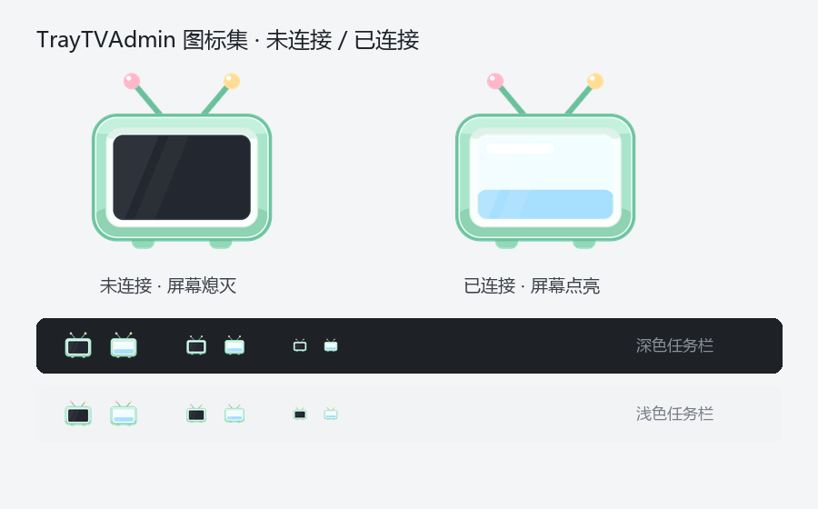

# tv-remote · Android TV admin panel (Windows tray)

A single tray icon to inspect and control an Android TV over **ADB over Wi-Fi**: hardware info,
memory/storage, network, processes, background services, boot-time receivers, and a live screen view.
No app needs to be installed on the TV.



The tray icon reflects connectivity: **dark screen = disconnected**, **lit screen = connected**.
The body is pixel-identical in both states; only the screen changes.

## Features

- Hardware overview: model, brand, Android version, ABI, serial, resolution
- Memory, uptime, `/data` and `/sdcard` usage
- Network: IP, Wi-Fi SSID, RSSI, link speed
- Foreground activity, top processes by RSS, running services
- Apps that listen to `BOOT_COMPLETED` (parsed from `dumpsys package`)
- Live screen via MJPEG (~1 fps, limited by `screencap`)
- Quick actions: launch a casting app, home, back, battery whitelist, screenshot
- Tray menu: open panel / copy URL / restart service / quit (quits the server too)

## Quick start

```bash
pip install -r requirements.txt
python main.py              # tray mode
python main.py --selftest   # headless self-check
```

A prebuilt `TrayTVAdmin.exe` is produced by `scripts/build.ps1`.

## Configuration

Copy `config.example.json` to `config.json` next to the exe (or repo root):

```json
{ "device": "192.168.1.10:5555", "port": 8777, "adb": "", "poll_seconds": 5 }
```

Environment overrides: `TVREMOTE_DEVICE`, `TVREMOTE_PORT`, `TVREMOTE_ADB`, `TVREMOTE_POLL`.

## HTTP API

| Method | Path | Description |
|---|---|---|
| GET | `/` | dashboard |
| GET | `/api/ping` | `{"server":true,"tv":true}` heartbeat |
| GET | `/api/status` | full status JSON |
| GET | `/api/screen` | MJPEG stream (single viewer) |
| POST | `/api/action` | `{"cmd":"home\|back\|castbay\|whitelist\|screenshot"}` |

## License

[MIT](LICENSE)
