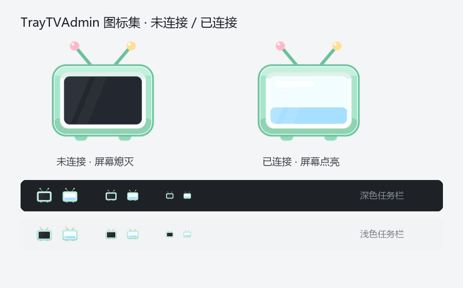

# tv-remote · 电视管理后台（Windows 托盘）

> 仓库：<https://github.com/knownothing20/tv-remote> · 最新版见 [Releases](https://github.com/knownothing20/tv-remote/releases)

[](LICENSE)


用一个托盘小图标管理家里的 Android TV：**硬件信息、内存/存储、网络、进程、后台服务、自启动清单、实时画面**，以及几个快捷操作。数据全部来自 **ADB over Wi-Fi**，不需要在电视上装任何 App。



> 图标双态：**屏幕黑 = 未连接**，**屏幕亮 = 已连接**。机身完全一致，只有屏幕变化。

## 特性

| 能力 | 说明 |
|---|---|
| 硬件概览 | 型号 / 品牌 / Android 版本 / CPU 架构 / 序列号 / 分辨率 / 构建号 |
| 资源 | 内存占用与可用、开机时长、`/data` 与 `/sdcard` 使用率 |
| 网络 | IP、Wi-Fi SSID、信号强度、链路速率 |
| 运行态 | 前台 Activity、进程 Top（按内存）、后台服务清单 |
| 自启动 | 解析 `dumpsys package`，列出监听 `BOOT_COMPLETED` 的应用 |
| 实时画面 | MJPEG 流，约 1 帧/秒（受电视 `screencap` 速度限制） |
| 快捷操作 | 打开指定投屏 App、回桌面、返回键、加省电白名单、保存截图 |
| 应用管理 | 应用列表 / 搜索、打开 / 停止 / 停用 / 清数据 / 卸载（含保护名单） |
| PWA | 可添加到主屏；浅色/深色主题；内存趋势曲线 |
| 守护 | 电视在线但投屏接收端未运行时**静默拉起**并退回原画面，播放中不打扰 |
| 托盘 | 右键菜单：打开面板 / 复制地址 / 重启服务 / 退出（退出即停服务） |

## 快速开始

### 方式一：直接运行 exe（推荐）

从 [**Releases**](https://github.com/knownothing20/tv-remote/releases/latest) 下载最新 `TrayTVAdmin.exe`（约 16 MB，免安装、不依赖 Python）。

1. 电视开启「开发者选项 → USB 调试 / 网络调试」，记下电视 IP
2. 电脑与电视在同一网段，先手动验证一次：`adb connect <电视IP>:5555`
3. 双击 `TrayTVAdmin.exe` → 托盘出现小电视 → 右键「打开管理后台」

首次启动有 2–4 秒自解压（单文件），属正常现象。

### 方式二：源码运行

```bash
pip install -r requirements.txt
python main.py                 # 托盘模式
python main.py --selftest      # 无界面自检
python main.py --export-icons assets/icons
```

也可以 `python -m tvremote`（需先把 `src` 加入 `PYTHONPATH`）。

## 局域网访问与 Docker

面板默认监听 `127.0.0.1`——**只有运行它的那台电脑能打开**。让 iPad / 手机也能访问，把 `host`
改成 `0.0.0.0`（或用环境变量 `TVREMOTE_HOST=0.0.0.0`）：

```json
{ "device": "192.168.1.10:5555", "host": "0.0.0.0", "port": 8777, "token": "" }
```

访问 `http://<电脑IP>:8777`。暴露到局域网时建议同时设置 `token`，
之后地址为 `http://<电脑IP>:8777/?token=你的口令`（托盘右键「打开管理后台」会自动使用局域网 IP 并带上口令，复制即可分享）。

### Docker（推荐常开）

镜像只跑 Web 面板（无托盘），适合 NAS / 小主机 7×24 常驻：

```bash
docker run -d --name tv-remote -p 8777:8777 \
  -e TVREMOTE_DEVICE=192.168.31.226:5555 \
  -e TVREMOTE_HOST=0.0.0.0 \
  -v $(pwd)/local:/app/local \
  --restart unless-stopped \
  ghcr.io/knownothing20/tv-remote:latest
```

镜像：`ghcr.io/knownothing20/tv-remote`（`amd64` / `arm64`，同时提供 `:vX.Y.Z` 版本标签）。
部署细节、adb 授权与排错见 [docs/DOCKER.md](docs/DOCKER.md)。

## 常用操作（Windows 桌面版）

| 想做的事 | 双击 |
|---|---|
| 启动托盘 | `TrayTVAdmin.lnk`（或 `Start-Tray.cmd` 备用） |
| 更新到最新版 | `Update-Latest.cmd`（调用 `scripts/Update-Latest.ps1`，下载并替换为最新 Release） |

`TrayTVAdmin.lnk` 固定指向仓库根目录的 `TrayTVAdmin.exe`，更新脚本会替换这个文件，
因此**快捷方式永远是当前最新版**。本地版本号写在 `local/version.txt`。

## 本地数据与隐私

所有本地信息集中在 **`local/`** 目录（已加入 `.gitignore`，不会进仓库）：

```
local/
├─ config.json     设备地址 / 端口 / adb 路径（首次运行自动生成）
├─ settings.json   界面设置（隐私开关、刷新间隔）
├─ logs/           tray.log / selftest.log / tray_error.log
└─ shots/          面板「保存截图」的产物
```

把 `config.example.json` 复制成 `local/config.json` 后修改（也可以直接改首次运行生成的那份）：

```json
{
  "device": "192.168.1.10:5555",
  "host": "127.0.0.1",
  "port": 8777,
  "adb": "",
  "token": "",
  "poll_seconds": 5
}
```

| 字段 | 说明 |
|---|---|
| `device` | 当前设备的 ADB 地址，`IP:端口`（多设备见 `local/devices.json`） |
| `host` | 监听地址；`127.0.0.1` 仅本机，`0.0.0.0` 允许局域网访问 |
| `port` | Web 面板端口，默认 `8777` |
| `adb` | adb 可执行文件路径，留空则自动在 `PATH` / `ANDROID_HOME` / 常见目录里找 |
| `token` | 可选访问口令；设置后请求需带 `?token=` 或 `X-Auth-Token` |
| `poll_seconds` | 托盘图标状态轮询间隔（秒） |

也可用环境变量覆盖：`TVREMOTE_DEVICE` / `TVREMOTE_HOST` / `TVREMOTE_PORT` / `TVREMOTE_ADB` /
`TVREMOTE_TOKEN` / `TVREMOTE_POLL`，命令行还支持 `--device`、`--host`、`--port`。

### 隐私脱敏

面板与日志默认**隐藏**设备标识（`local/settings.json` 中 `mask_sensitive: true`）：

| 原始值 | 实际展示 |
|---|---|
| `192.168.1.42:5555` | `192.168.*.*:5555` |
| 序列号 `6A1B2C3D...FE` | `6A****************FE` |
| Wi-Fi `Xiaomi_5G` | `Xi*****5G` |

面板右上角可切换「隐藏敏感信息」，选择会写回 `local/settings.json`；日志与错误堆栈里的 IP
也会被兜底遮蔽。分享截图或提 issue 时建议保持开启。

## 目录结构

```
tv-remote/
├─ main.py                  # 入口（PyInstaller 打包入口 / 源码运行）
├─ config.example.json      # 配置模板
├─ requirements.txt
├─ assets/
│  ├─ icons/                # tv_on.ico / tv_off.ico（16–256 全尺寸）+ 256px PNG
│  └─ preview/              # README 预览图
├─ docs/
│  ├─ ARCHITECTURE.md       # 架构与数据流
│  └─ ICONS.md              # 图标设计规范
├─ scripts/
│  ├─ build.ps1             # 一键打包 exe
│  └─ gen_icons.py          # 重新生成图标
├─ src/tvremote/
│  ├─ __init__.py           # 版本号
│  ├─ config.py             # 配置 / 设置 / local 目录（文件 / 环境变量 / 命令行）
│  ├─ privacy.py            # 隐私脱敏：IP、序列号、SSID、MAC、日志文本
│  ├─ adb.py                # adb 薄封装
│  ├─ server.py             # HTTP 服务：采集、REST、MJPEG
│  ├─ tray.py               # 托盘：菜单、双态图标、服务生命周期
│  ├─ icons.py              # 用 Pillow 绘制图标
│  └─ web/index.html        # 面板前端（单文件，无构建步骤）
└─ local/                   # 本地数据（gitignore）：配置、设置、日志、截图
```

## HTTP API

面板本身也是 API 消费者，可直接复用：

| 方法 | 路径 | 说明 |
|---|---|---|
| GET | `/` | 面板页面 |
| GET | `/api/ping` | 轻量心跳：`{"server":true,"tv":true}`（托盘图标用它） |
| GET / POST | `/api/devices` | 设备列表 / 切换 / 新增 / 删除 |
| GET | `/api/apps` | 已安装应用（`scope=third\|all`、`q=` 搜索） |
| POST | `/api/app` | 应用操作：`open` / `stop` / `disable` / `enable` / `clear` / `uninstall` |
| GET | `/api/update` | 查询 GitHub Releases 是否有新版本（30 分钟缓存） |
| GET | `/api/history` | 最近 3 分钟内存采样（趋势图数据） |
| GET / POST | `/api/settings` | 读取 / 修改界面设置（`mask_sensitive`、`refresh_seconds`） |
| GET | `/api/status` | 全量状态 JSON（硬件、内存、存储、网络、进程、服务、自启动…） |
| GET | `/api/screen` | MJPEG 实时画面（单路，多路会返回 429） |
| POST | `/api/action` | `{"cmd":"home\|back\|castbay\|whitelist\|screenshot"}` |

## 开发

```bash
# 重新生成图标（需要 Pillow）
python scripts/gen_icons.py

# 打包单文件 exe
powershell -ExecutionPolicy Bypass -File scripts/build.ps1
```

打包参数说明见 `scripts/build.ps1`；`pystray` 的后端是动态导入，必须带
`--hidden-import pystray._win32 --hidden-import pystray._base --hidden-import pystray._util.win32`。

## 已知限制

- **实时画面约 1 fps**：`screencap` 单帧在电视端就要几百毫秒到 1 秒；要 30–60fps 实时投屏请用 `scrcpy`。
- **单路观看**：同一时刻只允许一个客户端拉流，避免给电视增加负载。
- **依赖电视端 ADB**：电视休眠/断网/关闭调试后图标会变黑屏，需重新 `adb connect`。
- **自启动清单**需要拉取 `dumpsys package`（数 MB），因此首次加载异步完成，约 3–10 秒。
- 部分 TCL/国产电视对 `dumpsys` 输出做了裁剪，个别字段可能为空。

## 版本规划

当前 **v1.0.0**，遵循 [语义化版本](https://semver.org/lang/zh-CN/)；完整路线图见 [docs/ROADMAP.md](docs/ROADMAP.md)。

| 版本 | 主题 |
|---|---|
| v1.1.0 | 局域网访问 + Docker ✔ |
| v1.2.0 | 多设备管理 ✔ |
| v1.3.0 | 应用管理 ✔ |
| v1.4.0 | 更新检查 ✔ |
| v1.5.0 | **面板体验（PWA / 主题 / 趋势图）✔ 已发布** |
| v2.0.0 | 采集器插件化 + macOS / Linux 托盘 |

发布流程：改 `__version__` 与 `CHANGELOG.md` → 打 tag `vX.Y.Z` → CI 自动构建 exe 并挂到 Release。

## 许可

[MIT](LICENSE)
